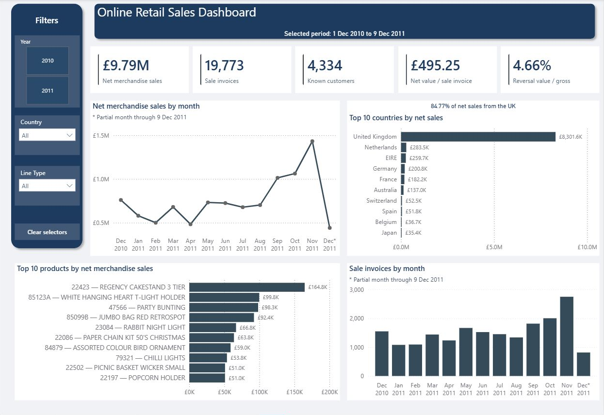
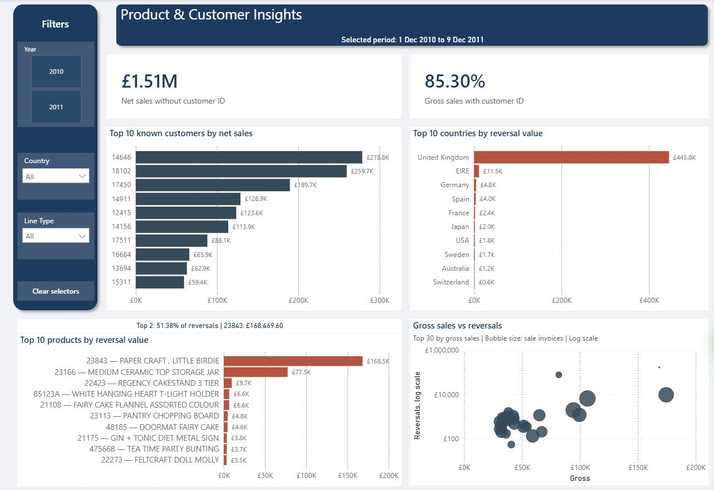

# Análisis de ventas de retail online del Reino Unido

[English](README.md) · **Español** · [Estado de CI](https://github.com/angel-wm/online-retail-sales-analysis/actions/workflows/source-static-validation.yml)

Proyecto de Power BI de dos páginas para explorar ventas de mercancía, cobertura de clientes y valor de cancelaciones/reversos del dataset Online Retail de UCI. Incluye un PBIX interactivo, el Excel original, las definiciones editables del reporte y del modelo, y comprobaciones financieras reproducibles.

- **[Abre el PBIX](exports/uk-online-retail-sales-analysis.pbix)** para explorar el reporte en Power BI Desktop con los datos ya cargados.
- **[Edita el PBIP](uk-online-retail-sales-analysis.pbip)** desde una copia completa del repositorio. La [guía de configuración](docs/SETUP.es.md) explica cómo conectar el Excel y actualizar el modelo.

Los importes están en **GBP (£)**, la moneda de la fuente. Los datos abarcan del **1 de diciembre de 2010 al 9 de diciembre de 2011**: 2010 sólo contiene diciembre y diciembre de 2011 está incompleto. Las transacciones negativas identifican reversos registrados; no acreditan devoluciones físicas ni insatisfacción de clientes.

## Abrir y explorar

Para **consultar el dashboard**, descarga y abre el [PBIX exportado](exports/uk-online-retail-sales-analysis.pbix) en Power BI Desktop. Puedes explorar los datos incluidos; para actualizarlos en otro equipo, debes configurar la ruta del Excel dentro de Desktop.

Para **desarrollar el proyecto PBIP**:

1. Clona o descarga el repositorio completo, incluidas `powerbi/` y `data/raw/`.
2. Ejecuta `python scripts/configure_source.py` para configurar la ubicación local del Excel y abre el PBIP de la raíz en Power BI Desktop.
3. Actualiza y explora **Sales Overview** y **Product & Customer Insights**. Los filtros Year, Country y Line Type están sincronizados. Antes de crear un commit, ejecuta `python scripts/configure_source.py --reset` para no publicar tu ruta local. Consulta [Configuración](docs/SETUP.es.md).

El reporte interactivo requiere Power BI Desktop en Windows. Python y .NET sólo se necesitan para el [procedimiento opcional de validación](docs/VALIDATION.es.md#ejecutar-las-comprobaciones).

## Vista previa del dashboard

Ambas capturas se tomaron del reporte revisado en Power BI Desktop el 27 de noviembre de 2026 con ambos años incluidos, Country y Line Type en All, y todas las selecciones de los gráficos despejadas.

### Sales Overview

La primera página reúne ventas netas de mercancía, facturas de venta, clientes conocidos, valor neto por factura y reversos como proporción del bruto. Ambos gráficos mensuales identifican diciembre de 2011 como mes parcial. Reino Unido representó el **84,77 % de las ventas netas de mercancía** en el período completo.

### Product & Customer Insights

La segunda página muestra cobertura de clientes y rankings por ventas netas o valor de reversos. Dos productos concentraron el **51,38 % del valor de los reversos de mercancía**, con el código `23843` a la cabeza por **£168.469,60**. La dispersión compara ventas brutas y reversos de los 30 productos principales por bruto. Su eje vertical es logarítmico y el tamaño de las burbujas representa facturas de venta.

Estas imágenes muestran las páginas renderizadas. El alcance de las comprobaciones numéricas y de interacción se explica en [Validación](docs/VALIDATION.es.md).

## Documentación

| Para… | Consulta |
| --- | --- |
| Abrir, configurar o resolver problemas del reporte | [Configuración](docs/SETUP.es.md) |
| Interpretar ventas, reversos y cobertura de clientes | [Métricas](docs/METRICS.es.md) |
| Entender tablas, relaciones e identidad de producto | [Modelo](docs/MODEL.es.md) |
| Consultar campos y reglas de clasificación | [Diccionario de datos](data/data-dictionary.es.md) |
| Entender la preparación y los límites de la fuente | [Notas de limpieza](docs/cleaning-notes.es.md) |
| Repetir comprobaciones y conocer su alcance | [Validación](docs/VALIDATION.es.md) |
| Comparar los resultados originales con los actuales | [Conciliación financiera](evidence/financial/RECONCILIATION.es.md) |
| Localizar archivos y distinguir los generados en local | [Estructura del proyecto](docs/PROJECT_STRUCTURE.es.md) |

## Fuente y licencia

La fuente versionada es [Online Retail.xlsx](data/raw/Online%20Retail.xlsx), con 541,909 líneas de transacción. Se conserva sin editar. El modelo mantiene 540,455 líneas después de la exclusión documentada de descripciones nulas y conserva las líneas repetidas.

**Cita del dataset:** Chen, D. (2015). *Online Retail* [Dataset]. UCI Machine Learning Repository. [DOI: 10.24432/C5BW33](https://doi.org/10.24432/C5BW33).

El dataset conserva su licencia **CC BY 4.0**; consulta [atribución y licencia de los datos](DATA_LICENSE.es.md). Los materiales propios del repositorio usan la [licencia MIT](LICENSE).

Creado por [Angel W. Miller](https://github.com/angel-wm).
