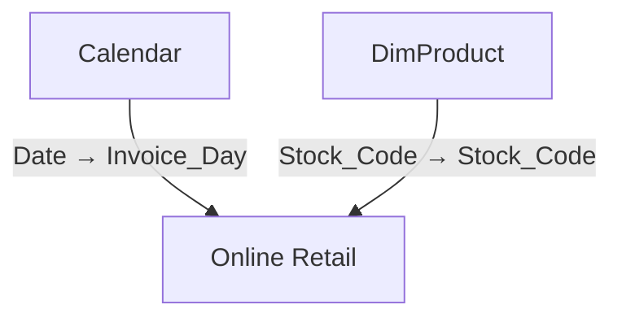

[Read in English](MODEL.md) · [Inicio en español](../README.es.md)

# Modelo y comportamiento del reporte

El modelo de importación vincula las líneas de factura con dimensiones de fechas y productos. [Definición TMDL](../powerbi/uk-online-retail-sales-analysis.SemanticModel/definition/model.tmdl) · [Diccionario de datos](../data/data-dictionary.es.md)

## Tablas y filtros

| Tabla | Nivel de detalle |
| --- | --- |
| `Online Retail` | 540.455 líneas de factura. Contiene 17 medidas financieras y de diagnóstico y cuatro medidas de texto. |
| `Calendar` | 374 días consecutivos entre los extremos de `Invoice_Day`. |
| `DimProduct` | 3.848 códigos de inventario normalizados, incluidos todos los tipos de línea cargados. |

Las dimensiones filtran las líneas mediante relaciones activas de uno a muchos y en una sola dirección. Con las dos tablas automáticas de fechas ocultas y el vínculo temporal original, el modelo tiene cinco tablas y tres relaciones. Los gráficos mensuales usan el calendario explícito. `YearMonth_Label` se ordena por `YearMonthSort` y marca con un asterisco el último mes si está incompleto. Los nombres de mes y día se ordenan por `Month#` y `Weekday#`, respectivamente. Las comprobaciones verificaron claves únicas, ausencia de huérfanos y conservación de filas e importes. [Evidencia del modelo](../evidence/validation/model-checks.json)

## Identidad de producto

El código de inventario identifica el producto. Para elegir su descripción representativa, `DimProduct` normaliza las descripciones con recorte y mayúsculas. Da prioridad a las líneas de venta elegibles y, si no existen, usa todas las líneas del código. Elige el texto más frecuente y resuelve empates por orden ordinal. `Product_Label` combina código y descripción con una raya. Se conservan la descripción original en la tabla de hechos y el número de variantes. Hay 642 códigos con varias descripciones y 212 con varias en líneas de venta elegibles. [Identidades y variantes](../evidence/financial/product_identity.csv)

## Medidas y origen

El modelo conserva doce medidas recuperadas y añade cinco de diagnóstico y conciliación, más cuatro medidas ocultas para el período, el mes parcial, la participación del Reino Unido y la concentración de reversos. El parámetro portátil `SourceFilePath` se configura localmente para refrescar el PBIP. El PBIX tiene su propio parámetro. [Métricas](METRICS.es.md) · [Configuración](SETUP.es.md)

## Páginas e interacciones

El reporte tiene 35 contenedores visuales, incluidos los 31 originales, dos tarjetas de cobertura y dos notas de ranking. **Sales Overview** presenta los diez países y productos con mayores ventas netas. **Product & Customer Insights** muestra los diez clientes identificados principales por ventas netas, los diez países y productos por importe de reversos y una dispersión de hasta 30 productos por ventas brutas. Las notas calculan sus porcentajes sobre toda la selección. El tamaño de las burbujas representa facturas de venta.

Year, Country y Line Type se sincronizan entre páginas. Una selección en un gráfico filtra otros visuales de su página y deja estables las listas de selectores. **Clear selectors** limpia los tres selectores. Los Top N y las marcas seleccionadas tienen su propio comportamiento. [Configuración de interacciones](../evidence/validation/report-checks.json) · [Alcance de las pruebas](VALIDATION.es.md)
