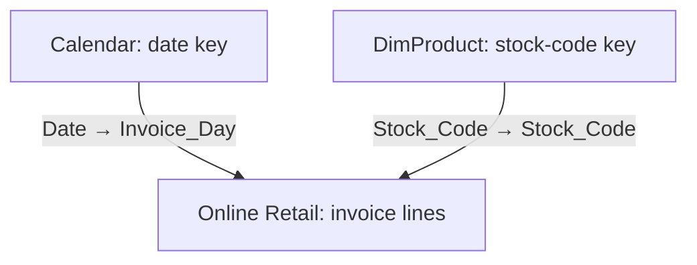

# Model and report behavior

The import model joins invoice lines to a date dimension and a stock-code dimension. Its implementation is in the [semantic model definition](../powerbi/uk-online-retail-sales-analysis.SemanticModel/definition/model.tmdl); the [data dictionary](../data/data-dictionary.md) describes individual fields.

## Main tables and filter paths

| Table | Grain and role |
| --- | --- |
| `Online Retail` | One loaded invoice line; 540,455 rows. All 17 measures are defined here. |
| `Calendar` | One date; 374 continuous dates spanning the loaded source. |
| `DimProduct` | One normalized stock code; 3,848 keys across all loaded line types. |

Both main relationships are active, one-to-many and single-direction: the dimensions filter invoice lines. The model also preserves two hidden automatic date tables and the original invoice-timestamp relationship. There are **five tables and three relationships** in total. The report's monthly categories use the explicit Calendar, not the hidden automatic date hierarchy.

`Calendar[YearMonth_Label]` is sorted by `YearMonthSort`; month names are sorted by `Month#` and weekday names by `Weekday#`. The Calendar is generated from the minimum and maximum loaded `Invoice_Day`. Date coverage and the final partial month are explained in [Metrics](METRICS.md#period-coverage).

The current parser and join checks confirm unique dimension keys, no orphan product or date rows, unchanged fact-row count after the join and unchanged financial totals. See [model-checks.json](../evidence/validation/model-checks.json) for the checked scenarios.

## Product identity

Stock code is the product key. The original fact description is retained; a varying description does not create another product, and different codes are not merged merely because their descriptions match.

For each stock code, `DimProduct` chooses a representative description as follows:

1. Trim and uppercase the source descriptions.
2. Prefer descriptions on eligible positive merchandise sale lines. If there are none, use all loaded lines for that code.
3. Choose the most frequent normalized description. Resolve a frequency tie by ordinal text order.
4. Build `Product_Label` as stock code, an em dash and the chosen description. Retain the count of normalized description variants.

This is a deterministic label for grouping, not an authoritative product catalogue. The source has 642 loaded codes with multiple description variants, including 212 codes with multiple descriptions on eligible sale lines. [product_identity.csv](../evidence/financial/product_identity.csv) records the chosen labels and variant counts.

## Measures and source parameter

The 12 recovered measure names and their lineage tags are preserved, with five additional measures for administrative adjustments, other movements, reversed units and customer coverage. Existing report references therefore continue to use their original measure names. Business meanings and limits have their reference in [Metrics](METRICS.md).

`SourceFilePath` is the sole Excel-location parameter. The versioned TMDL uses a neutral placeholder, not a machine-specific Excel location. Before refreshing the PBIP, set the local absolute path with `python scripts/configure_source.py` or Power Query Manage Parameters. Restore the neutral placeholder with `--reset` before committing this tracked TMDL file. The path cannot be inferred from the PBIP location by Power Query; see the [setup procedure](SETUP.md#configure-and-open). This configuration does not modify the separate PBIX snapshot.

## Report pages and rankings

The report contains **Sales Overview** and **Product & Customer Insights**, with 33 visual containers: the 31 original containers and two customer-coverage cards. No historical authoring script is required to open or validate it.

| Visual | Ranking or encoding |
| --- | --- |
| Top products and countries on Sales Overview | Top 10 by net merchandise sales. |
| Known-customer ranking | Top 10 identified customer IDs by net merchandise sales. |
| Country and product reversal rankings | Top 10 by merchandise reversal value. |
| Gross sales vs reversals | Top 30 products by gross sales; X is gross, Y is reversal value on a log axis, bubble size is sale invoices. |

Top N rules are evaluated under the current filters. The country rankings have no hidden £1,000 threshold or manual country exclusion. Filters that reduce the eligible population can reduce the visible ranking or scatter point count. Product groupings use `DimProduct`, avoiding separate bars for description variants.

## Selectors and chart interactions

Year, Country and Line Type use shared synchronization groups across both pages. The Year control displays 2010 and 2011 together as stacked buttons. The **Clear selectors** action clears the three slicers.

The configured interactions send selector and chart selections to cards and charts on the same page. Chart selections do not filter the selector lists. Clear selectors does not promise to clear selected chart marks or remove Top N rules.

These are configuration facts checked in [report-checks.json](../evidence/validation/report-checks.json). Native checks covered the rendered pages and selected filter cases; the complete interaction checklist remains separate in [Validation](VALIDATION.md#remaining-desktop-acceptance).
